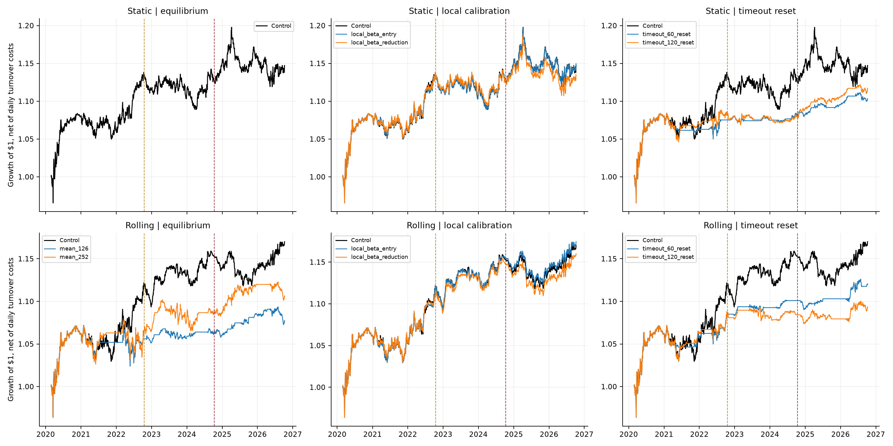
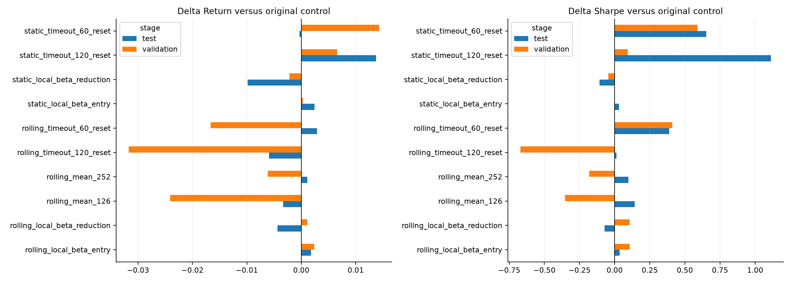

# Exploratory strategy iterations: a positive backtest is not independent validation

The validation rule nominates **static_timeout_60_reset** for future paper evaluation. It improves validation return by 1.43% and Sharpe by 0.588.

This batch contains 10 candidates fixed in [the iteration protocol](../../experiments/protocol.md) before batch execution. The previous historical holdout had already been examined. All results here are exploratory; no repeated search for statistical significance or concealed unsuccessful strategies is used. The original hypothesis and negative primary result in [the original study](../run/research_report.md) remain intact.

## What improved?

5 of 10 candidates improve both net cumulative return and Sharpe in validation; 5 do so in the previously viewed test. 3 improve both metrics in both periods: rolling_local_beta_entry, static_local_beta_entry, static_timeout_120_reset.

The validation rule nominates **static_timeout_60_reset** for future paper evaluation. It improves validation return by 1.43% and Sharpe by 0.588.

| strategy                | stage      |   return |   sharpe |   delta_return |   delta_sharpe |   max_drawdown |   capital_utilization |   risk_scaled_control_return |   completed_trades |   timeouts |
|:------------------------|:-----------|---------:|---------:|---------------:|---------------:|---------------:|----------------------:|-----------------------------:|-------------------:|-----------:|
| static_timeout_60_reset | validation |   0.0080 |   0.5135 |         0.0143 |         0.5883 |        -0.0093 |                0.0741 |                      -0.0024 |                  4 |          4 |
| static_timeout_60_reset | test       |   0.0178 |   0.8878 |        -0.0003 |         0.6509 |        -0.0105 |                0.0882 |                       0.0020 |                  8 |          4 |

## All candidates versus unchanged controls

All returns are simple adjusted leg returns, charging 5 bp on actual daily leg turnover. Reference-log approximations are not used. Frozen IS hedge ratios and sigma are retained. Local filters change threshold calibration only. Shorter means change equilibrium estimation only. Time-out/reset strategies explicitly add a risk-control exit and a rearm rule. These extensions do not modify the original replication.

| strategy                     | stage      |   return |   sharpe |   delta_return |   delta_sharpe |   max_drawdown |   capital_utilization |   risk_scaled_control_return |   completed_trades |   timeouts |
|:-----------------------------|:-----------|---------:|---------:|---------------:|---------------:|---------------:|----------------------:|-----------------------------:|-------------------:|-----------:|
| rolling_mean_126             | validation |   0.0089 |   0.3807 |        -0.0241 |        -0.3528 |        -0.0118 |                0.0880 |                       0.0177 |                  5 |          0 |
| rolling_mean_126             | test       |   0.0112 |   0.4353 |        -0.0034 |         0.1430 |        -0.0191 |                0.1080 |                       0.0052 |                  7 |          0 |
| rolling_mean_252             | validation |   0.0269 |   0.5523 |        -0.0062 |        -0.1813 |        -0.0331 |                0.2135 |                       0.0253 |                 10 |          0 |
| rolling_mean_252             | test       |   0.0156 |   0.3900 |         0.0011 |         0.0977 |        -0.0191 |                0.2311 |                       0.0124 |                  9 |          0 |
| static_local_beta_entry      | validation |  -0.0060 |  -0.0746 |         0.0003 |         0.0002 |        -0.0403 |                0.7034 |                      -0.0060 |                  4 |          0 |
| static_local_beta_entry      | test       |   0.0206 |   0.2680 |         0.0024 |         0.0310 |        -0.0656 |                0.6927 |                       0.0176 |                  8 |          0 |
| static_local_beta_reduction  | validation |  -0.0085 |  -0.1202 |        -0.0022 |        -0.0454 |        -0.0391 |                0.6731 |                      -0.0058 |                  4 |          0 |
| static_local_beta_reduction  | test       |   0.0083 |   0.1288 |        -0.0099 |        -0.1082 |        -0.0685 |                0.6218 |                       0.0169 |                  8 |          0 |
| rolling_local_beta_entry     | validation |   0.0354 |   0.8404 |         0.0024 |         0.1068 |        -0.0244 |                0.2178 |                       0.0307 |                  7 |          0 |
| rolling_local_beta_entry     | test       |   0.0164 |   0.3272 |         0.0018 |         0.0348 |        -0.0351 |                0.4193 |                       0.0126 |                  6 |          0 |
| rolling_local_beta_reduction | validation |   0.0342 |   0.8410 |         0.0011 |         0.1075 |        -0.0231 |                0.2228 |                       0.0308 |                  7 |          0 |
| rolling_local_beta_reduction | test       |   0.0102 |   0.2206 |        -0.0044 |        -0.0717 |        -0.0348 |                0.3879 |                       0.0129 |                  6 |          0 |
| static_timeout_60_reset      | validation |   0.0080 |   0.5135 |         0.0143 |         0.5883 |        -0.0093 |                0.0741 |                      -0.0024 |                  4 |          4 |
| static_timeout_60_reset      | test       |   0.0178 |   0.8878 |        -0.0003 |         0.6509 |        -0.0105 |                0.0882 |                       0.0020 |                  8 |          4 |
| static_timeout_120_reset     | validation |   0.0003 |   0.0175 |         0.0066 |         0.0923 |        -0.0143 |                0.1332 |                      -0.0032 |                  6 |          6 |
| static_timeout_120_reset     | test       |   0.0319 |   1.3486 |         0.0137 |         1.1116 |        -0.0105 |                0.1271 |                       0.0035 |                  7 |          2 |
| rolling_timeout_60_reset     | validation |   0.0164 |   1.1441 |        -0.0167 |         0.4106 |        -0.0078 |                0.0606 |                       0.0148 |                  6 |          4 |
| rolling_timeout_60_reset     | test       |   0.0174 |   0.6807 |         0.0029 |         0.3884 |        -0.0104 |                0.0848 |                       0.0036 |                  7 |          6 |
| rolling_timeout_120_reset    | validation |   0.0013 |   0.0626 |        -0.0317 |        -0.6710 |        -0.0145 |                0.1067 |                       0.0182 |                  8 |          5 |
| rolling_timeout_120_reset    | test       |   0.0086 |   0.3046 |        -0.0059 |         0.0123 |        -0.0129 |                0.1554 |                       0.0063 |                  6 |          4 |

Absolute returns are decimal fractions; delta_return is the difference in compounded returns, not an additive P&L attribution. Capital-use-matched controls use exposure ratios known before the evaluation period; they are not scaled using future realized volatility. Compare return, drawdown, utilization and matched-control returns together. Entry counts, turnover and arithmetic cost totals are in `strategy_metrics.csv`. Time-out counts identify forced exits. Completed trades use exit dates; final open positions remain marked to market.

## Economic gains versus statistical evidence

0 paired net-return comparisons have a positive advantage, a positive block-bootstrap lower limit, and Holm q<0.05 across their ten-candidate stage family. Validation and retrospective test are corrected separately. The nominal significance family does not account for all earlier research and cannot make the reused test independent.

| strategy                     | stage      |   annualized_mean_advantage |   ci_low |   ci_high |   p_value |   q_holm |   independent_blocks_approx |
|:-----------------------------|:-----------|----------------------------:|---------:|----------:|----------:|---------:|----------------------------:|
| rolling_mean_126             | validation |                    -0.01212 | -0.00017 |   0.00007 |   0.44667 |  1.00000 |                     8.31667 |
| rolling_mean_126             | test       |                    -0.00193 | -0.00015 |   0.00014 |   0.91988 |  1.00000 |                     8.31667 |
| rolling_mean_252             | validation |                    -0.00298 | -0.00014 |   0.00011 |   0.84615 |  1.00000 |                     8.31667 |
| rolling_mean_252             | test       |                     0.00041 | -0.00014 |   0.00016 |   0.98406 |  1.00000 |                     8.31667 |
| static_local_beta_entry      | validation |                     0.00011 | -0.00001 |   0.00001 |   0.93147 |  1.00000 |                     8.31667 |
| static_local_beta_entry      | test       |                     0.00119 | -0.00000 |   0.00001 |   0.30296 |  1.00000 |                     8.31667 |
| static_local_beta_reduction  | validation |                    -0.00121 | -0.00003 |   0.00001 |   0.64568 |  1.00000 |                     8.31667 |
| static_local_beta_reduction  | test       |                    -0.00507 | -0.00004 |   0.00000 |   0.09914 |  0.99140 |                     8.31667 |
| rolling_local_beta_entry     | validation |                     0.00111 | -0.00001 |   0.00002 |   0.61394 |  1.00000 |                     8.31667 |
| rolling_local_beta_entry     | test       |                     0.00090 |  0.00000 |   0.00001 |   0.28027 |  1.00000 |                     8.31667 |
| rolling_local_beta_reduction | validation |                     0.00050 | -0.00001 |   0.00002 |   0.80197 |  1.00000 |                     8.31667 |
| rolling_local_beta_reduction | test       |                    -0.00223 | -0.00003 |   0.00001 |   0.34920 |  1.00000 |                     8.31667 |
| static_timeout_60_reset      | validation |                     0.00664 | -0.00013 |   0.00018 |   0.71460 |  1.00000 |                     8.31667 |
| static_timeout_60_reset      | test       |                    -0.00101 | -0.00019 |   0.00021 |   0.96735 |  1.00000 |                     8.31667 |
| static_timeout_120_reset     | validation |                     0.00281 | -0.00011 |   0.00012 |   0.85791 |  1.00000 |                     8.31667 |
| static_timeout_120_reset     | test       |                     0.00595 | -0.00014 |   0.00023 |   0.79442 |  1.00000 |                     8.31667 |
| rolling_timeout_60_reset     | validation |                    -0.00844 | -0.00014 |   0.00009 |   0.55280 |  1.00000 |                     8.31667 |
| rolling_timeout_60_reset     | test       |                     0.00118 | -0.00012 |   0.00013 |   0.94180 |  1.00000 |                     8.31667 |
| rolling_timeout_120_reset    | validation |                    -0.01594 | -0.00016 |   0.00003 |   0.17732 |  1.00000 |                     8.31667 |
| rolling_timeout_120_reset    | test       |                    -0.00320 | -0.00011 |   0.00011 |   0.81792 |  1.00000 |                     8.31667 |

Paired return differences are computed on common dates from equal allocated pair portfolios; shared ETF exposures are not treated as independent experiments. HAC uses 60 sessions; circular shared-date block bootstrap uses 499 replications. Each period has only about eight such blocks. These approximations assume sufficient weak dependence and condition on already chosen rules. A small positive economic backtest is insufficient to claim a general forecasting advantage.

## Walk-forward and transaction-cost sensitivity

| strategy                     |   folds |   positive_return_folds |   positive_sharpe_folds |
|:-----------------------------|--------:|------------------------:|------------------------:|
| rolling_local_beta_entry     |       6 |                       4 |                       5 |
| rolling_local_beta_reduction |       6 |                       2 |                       5 |
| rolling_mean_126             |       6 |                       2 |                       2 |
| rolling_mean_252             |       6 |                       1 |                       2 |
| rolling_timeout_120_reset    |       6 |                       1 |                       2 |
| rolling_timeout_60_reset     |       6 |                       2 |                       5 |
| static_local_beta_entry      |       6 |                       3 |                       3 |
| static_local_beta_reduction  |       6 |                       3 |                       3 |
| static_timeout_120_reset     |       6 |                       3 |                       4 |
| static_timeout_60_reset      |       6 |                       2 |                       4 |

These consecutive 252-session folds begin after the initial 252 OOS sessions; a fold is split at the original test boundary. The final short fold is retained. Rules are not reselected per fold. See `walk_forward.csv` for every fold's return and drawdown. Val/test rows also compare five- and ten-basis-point costs for every candidate, without choosing the favorable cost assumption.

| strategy                     | stage      |   return |   sharpe |   delta_return |   delta_sharpe |   transaction_costs |
|:-----------------------------|:-----------|---------:|---------:|---------------:|---------------:|--------------------:|
| rolling_mean_126             | validation |   0.0081 |   0.3474 |        -0.0237 |        -0.3595 |              0.0016 |
| rolling_mean_126             | test       |   0.0101 |   0.3935 |        -0.0027 |         0.1355 |              0.0022 |
| rolling_mean_252             | validation |   0.0254 |   0.5241 |        -0.0064 |        -0.1828 |              0.0028 |
| rolling_mean_252             | test       |   0.0140 |   0.3516 |         0.0013 |         0.0936 |              0.0031 |
| static_local_beta_entry      | validation |  -0.0082 |  -0.1079 |         0.0004 |        -0.0003 |              0.0044 |
| static_local_beta_entry      | test       |   0.0180 |   0.2366 |         0.0025 |         0.0309 |              0.0052 |
| static_local_beta_reduction  | validation |  -0.0112 |  -0.1641 |        -0.0027 |        -0.0565 |              0.0055 |
| static_local_beta_reduction  | test       |   0.0053 |   0.0893 |        -0.0102 |        -0.1164 |              0.0060 |
| rolling_local_beta_entry     | validation |   0.0342 |   0.8133 |         0.0024 |         0.1064 |              0.0023 |
| rolling_local_beta_entry     | test       |   0.0146 |   0.2928 |         0.0018 |         0.0349 |              0.0036 |
| rolling_local_beta_reduction | validation |   0.0328 |   0.8081 |         0.0010 |         0.1012 |              0.0027 |
| rolling_local_beta_reduction | test       |   0.0082 |   0.1806 |        -0.0045 |        -0.0773 |              0.0039 |
| static_timeout_60_reset      | validation |   0.0072 |   0.4676 |         0.0158 |         0.5752 |              0.0014 |
| static_timeout_60_reset      | test       |   0.0168 |   0.8361 |         0.0013 |         0.6304 |              0.0021 |
| static_timeout_120_reset     | validation |  -0.0007 |  -0.0238 |         0.0079 |         0.0837 |              0.0019 |
| static_timeout_120_reset     | test       |   0.0308 |   1.3033 |         0.0153 |         1.0977 |              0.0021 |
| rolling_timeout_60_reset     | validation |   0.0156 |   1.0935 |        -0.0161 |         0.3866 |              0.0014 |
| rolling_timeout_60_reset     | test       |   0.0164 |   0.6402 |         0.0036 |         0.3823 |              0.0021 |
| rolling_timeout_120_reset    | validation |   0.0004 |   0.0225 |        -0.0314 |        -0.6844 |              0.0019 |
| rolling_timeout_120_reset    | test       |   0.0074 |   0.2631 |        -0.0053 |         0.0052 |              0.0024 |

## Interpretation and next evidence

A time-out/reset rule can improve performance by reducing exposure to a persistent deviation. It supplies no direct test that a statistical instability detector predicted the breakdown. Shorter means can alter opportunity frequency without explaining structural changes. Improvements from local calibration test whether a static threshold's vintage was unhelpful, not whether discrete market regimes exist. These mechanisms and their capital use must remain distinct.

The nominated strategy, if any, is frozen in `prospective_candidate.json` for paper evaluation starting October 19, 2026. It is nominated from validation only; its already viewed test results are disclosed rather than used to change its settings. No prospective performance has yet occurred in this study. No live trading orders are placed.

Reproduce with `OPENBLAS_NUM_THREADS=1 OMP_NUM_THREADS=1 .venv/bin/python -m experiments.run`. Daily portfolio series, trades, local thresholds, pair attribution, all negative cases, fixed specifications and code/data hashes are preserved. Three strategy families receive separate commits; neither a successful run nor a commit implies statistical validation.
