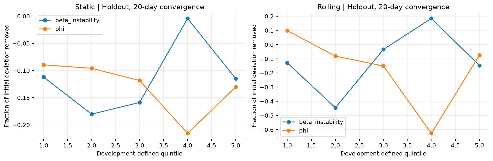
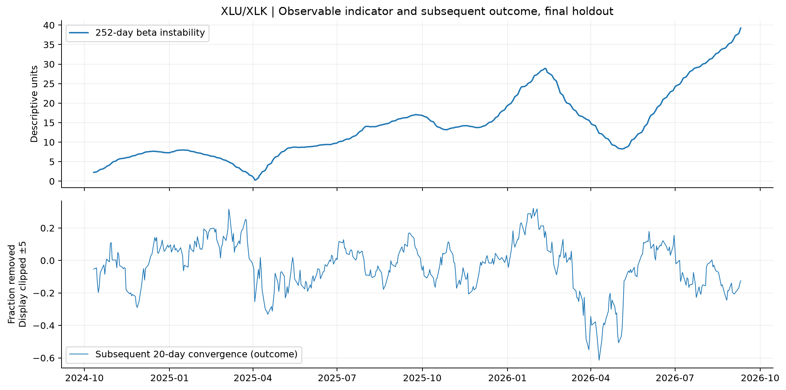
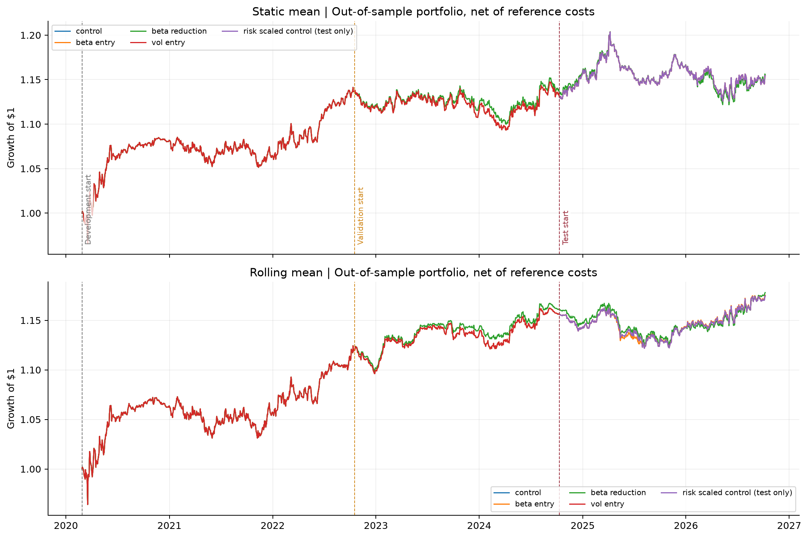
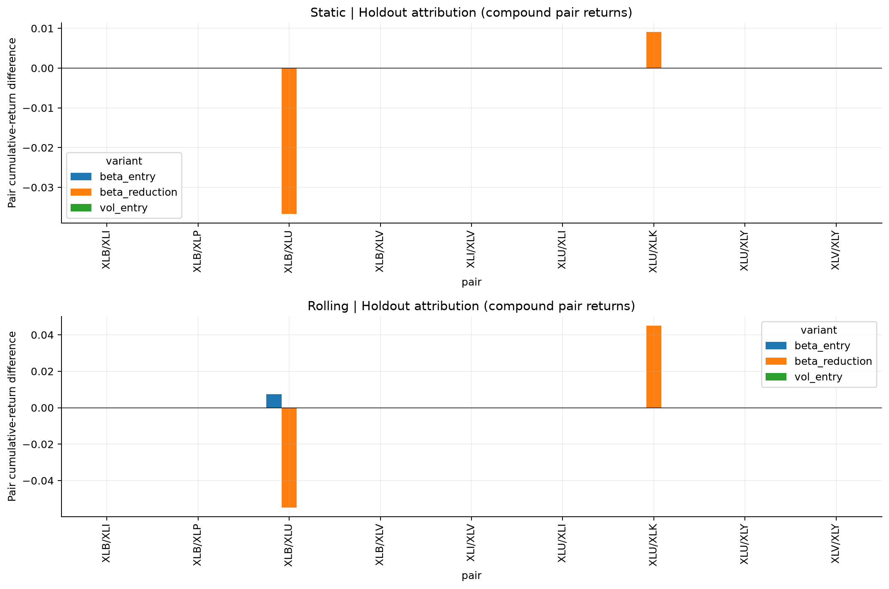
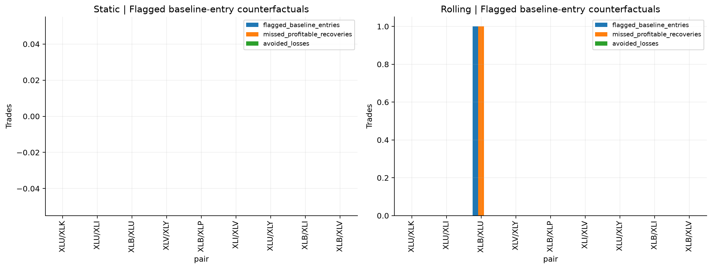

# Do Structural Instability Measures Predict the Breakdown of Equity Pairs Relationships? Evidence from Sector ETF Cointegration

## 1. Research motivation

H1: observable instability in historically cointegrated sector ETF pairs contains incremental information about subsequent convergence and net trading performance. The null is no incremental predictive information beyond spread magnitude, volatility, recent spread returns, and matured trailing convergence. This study neither identifies hidden regimes nor assumes an unconditional stationary return distribution. Detecting change, forecasting deterioration, and improving trading are distinct questions.

## 2. Original methodology and replication

See [the complete baseline assessment](baseline_replication.md), including all 55 pairs, both orientations, multiple-testing diagnostics, the nine historical pairs, and numerical differences from the supplied report. Data cover 2004-09-29–2026-10-08, with 5542 sessions. The reference 70/30 dates match: **True**. Exact reproduction of all rounded performance targets is not asserted. All extensions use the historical nine fitted in the report's orientations; reproduced-selection baseline portfolios are separate artifacts.

## 3. Competing hypotheses and chronological protocol

The designated primary family consists of four incremental forecasting comparisons: beta instability or AR persistence, each for static or rolling equilibrium, using a 252-day window and 20-day fractional convergence outcome. Directionally, higher instability or persistence is expected to reduce convergence. The 126/504-day windows, 5/60-day horizons, binary hits, capped convergence times, adverse excursions, future AR coefficients, and trading returns are exploratory. No specification is selected using final test results. Models are linear and interpretable; binary outcomes use clipped linear-probability predictions and Brier loss.

Specification choices were encoded before the first extension execution, but the written protocol was consolidated during implementation after an initial run. Accounting and numerical checks subsequently corrected label-cost timing, unidentified nuisance directions and missing-session gaps. The directional interpretation rule was made explicit during review. This is not an independent preregistration; the primary family organizes retrospective evidence rather than establishing pristine confirmatory status.

| stage       | start      | end        |    n |
|:------------|:-----------|:-----------|-----:|
| selection   | 2004-09-29 | 2020-02-26 | 3879 |
| development | 2020-02-27 | 2022-10-14 |  665 |
| validation  | 2022-10-17 | 2024-10-10 |  499 |
| test        | 2024-10-11 | 2026-10-08 |  499 |

Initial pair selection and frozen model estimation use only selection dates. The first 40% of original OOS is development: detector scaling, forecast coefficients, quintile edges and 90th-percentile filter thresholds. The next 30% is validation, with unchanged specifications; final 30% is the test. Labels crossing a stage's end are purged at their own horizon. No test observations calibrate features or thresholds. Pair intercepts and predictor scaling/clipping are fitted only on development; no cross-sectional sharing of future labels is permitted. Trading variants begin after development and carry existing positions across validation/test boundaries. Metrics count return realizations in each stage; completed trades are attributed by exit date.

The historical reference and known pair universe already reflect prior research. This is a chronological backtest holdout within a historically specified study, not a pristine prospective replication. No claim of an unexamined future holdout is made.

## 4. Structural-instability measures

Rolling OLS windows of 126, 252 and 504 sessions produce alpha, beta, residual dispersion, beta departure from the original estimate, recent 20-day change, history-standardized beta deviations, and descriptive |beta_t−beta_IS|/SE(beta_t). OLS standard errors in price-level regressions are normalization devices, not validated structural-break inference for integrated regressors. A 63-day standardized sum of frozen residual departures is a descriptive CUSUM indicator with no conventional critical values or break-test p-values.

Trailing AR(1) models of the original frozen spread estimate phi, lambda=phi−1, innovation dispersion and half-life ln(0.5)/ln(phi) only for 0<phi<1. Other half-lives are missing; negative phi is separately flagged as oscillatory. Descriptive normal intervals are provided for phi. Half-life interval endpoints are defined only where transformed endpoints lie inside (0,1); a confidence interval crossing 1 has no finite upper half-life. Local finite-window estimates and their intervals neither establish stationarity nor supply reliable unit-root inference. Large half-lives are visually capped but stored unmodified.

The simple trailing convergence predictor uses entry-sized deviations observed 20 sessions ago and their now fully observed subsequent 20-session hit histories, averaged over 126 sessions with at least five eligible observations. This predictor is sparse by design; missing values are not filled with future outcomes. Complete-case predictive sample counts are reported, and comparisons use the same rows for baseline and extended forecasts.

## 5. Predictive evaluation methodology

Outcomes begin strictly after the feature timestamp, at horizons 5, 20 and 60 sessions. Fractional convergence is 1−|s_(t+h)−mean_t|/|s_t−mean_t|: the equilibrium at t stays frozen for the outcome, including when trading uses a rolling equilibrium. Initial distances smaller than 0.05 sigma_IS are excluded, preventing unstable denominators near zero; the fraction is unbounded below and not clipped in statistical calculations. Convergence hits require |s_(t+j)−mean_t|≤0.25 sigma_IS. First-hit time is capped at h+1 for no hit, explicitly an ordinal capped outcome rather than an uncensored survival estimate. Maximum adverse excursion follows direction −sign(s_t−mean_t), in units of frozen sigma, floored at zero.

Hypothetical current-direction trades earn returns beginning next session, follow the original future exit rule, and close for label mark-out at the horizon if no exit occurs. Entry and exit costs are included; censored horizon closes are labeled. All-date hypothetical entries, actual baseline entry opportunities, and existing positions are evaluated separately. Existing-position continuation excludes the sunk entry cost and respects the actual held direction. These are frozen-direction trade mark-outs, not overlapping observations claimed to be independent executed trades. A future-only AR coefficient uses exactly s_(t+1) through s_(t+h); at short horizons it is extremely noisy and purely exploratory.

Baseline forecasts contain |z|, 20-day spread-change volatility, signed 20-day spread change, trailing matured convergence and pair intercepts. Extended forecasts add one instability measure at a time. Development fits use common one/99-percentile clipping and development standardization; coefficients stay frozen. Quantile edges also come solely from development.

Forecast loss improvement is baseline squared error minus extended squared error (positive favors instability), averaged within each date and then across dates. Binary comparisons use Brier scores. Date-level HAC uses at least 60 lags; date-aggregated regression scores account for contemporaneous dependence from shared ETFs. Circular moving-date bootstrap uses 60-day blocks, 499 deterministic replications, and the entire cross-section of each sampled date. Its interval is conditional on the fitted development model and does not re-estimate pair selection. Rank correlations and holdout partial-association coefficients are descriptive supplements; holdout refits never generate trading forecasts.

Holm correction is applied to the four primary holdout forecast-loss comparisons. BY correction covers all estimable test forecast-loss comparisons, and separately all holdout association coefficients. Validation p-values are descriptive. HAC and block bootstrap assume sufficient local weak dependence and do not solve arbitrary nonstationarity. The effective number of 60-session blocks is explicitly reported; a small holdout and rare independent entries severely limit power. No daily cross-section is treated as a collection of independent experiments.

## 6. Out-of-sample results

0 of 4 designated primary comparisons show positive forecast-loss improvement with Holm p<0.05, a positive block-bootstrap lower confidence limit, and the expected negative convergence association in development and holdout.

| strategy   | feature          |   n_train |         n |   n_dates |   independent_blocks_approx |   baseline_mse |   extended_mse |   mse_gain |   gain_ci_low |   gain_ci_high |   p_gain |   q_primary_gain_holm |   coefficient |   rank_correlation |
|:-----------|:-----------------|----------:|----------:|----------:|----------------------------:|---------------:|---------------:|-----------:|--------------:|---------------:|---------:|----------------------:|--------------:|-------------------:|
| rolling    | beta_instability | 3625.0000 | 1839.0000 |  479.0000 |                      7.9833 |         1.0186 |         1.0125 |     0.0060 |       -0.0063 |         0.0195 |   0.3928 |                0.6950 |       -0.0968 |             0.0127 |
| rolling    | phi              | 3625.0000 | 1839.0000 |  479.0000 |                      7.9833 |         1.0186 |         1.0075 |     0.0111 |       -0.0021 |         0.0269 |   0.1145 |                0.4578 |       -0.3569 |            -0.1181 |
| static     | beta_instability | 3810.0000 | 3309.0000 |  479.0000 |                      7.9833 |         0.8240 |         0.8268 |    -0.0028 |       -0.0081 |         0.0023 |   0.3295 |                0.6950 |        0.0173 |             0.0417 |
| static     | phi              | 3810.0000 | 3309.0000 |  479.0000 |                      7.9833 |         0.8240 |         0.8174 |     0.0066 |       -0.0043 |         0.0184 |   0.2317 |                0.6950 |        0.0540 |             0.0318 |

Full validation, holdout, negative, and insufficient-sample results are retained in `predictive_results.csv`. No failed specification is suppressed. A positive partial association or an unadjusted small p-value does not establish incremental forecasting value. Evidence consistent with deterioration also requires the expected sign; improvements in loss could arise from predictive relationships with other signs and must not automatically be interpreted as support for H1.

Across all exploratory outcomes, 2 adjusted loss comparisons favor the extended forecast and 32 favor the simpler forecast. A significant negative loss gain means that adding the indicator worsens forecasting. The adjusted improvements are shown below; signs of development and test associations remain visible. The rolling 504-day beta_instability / 20-day future-phi improvement is exploratory evidence for persistence forecasting, requiring prospective replication and economic validation. The static 504-day beta_instability / 60-day convergence improvement has greater convergence at higher indicator values, contrary to the proposed deterioration direction.

| strategy   |   window |   horizon | feature          | outcome     |   mse_gain |   gain_ci_low |   gain_ci_high |   q_gain_by |   development_coefficient |   coefficient |
|:-----------|---------:|----------:|:-----------------|:------------|-----------:|--------------:|---------------:|------------:|--------------------------:|--------------:|
| rolling    |      504 |        20 | beta_instability | future_phi  |     0.0009 |        0.0003 |         0.0015 |      0.0451 |                    0.0214 |        0.0835 |
| static     |      504 |        60 | beta_instability | convergence |     0.0226 |        0.0099 |         0.0336 |      0.0292 |                    0.0092 |        0.7937 |

## 7. Trading implications

Entry thresholds remain ±1.5 and exit remains |z|≤0.25. All main controls and modifications use simple leg returns; the reference's compounded log-spread approximation is separately preserved as `reference_log_control`. Main modifications use the development 90th percentile of 252-day descriptive beta instability: suspend new entries while high, or halve exposure while high. Open positions under the entry filter retain the original exit rule. Half-exposure changes incur costs and freed capital earns zero; other pairs receive no reallocation. A 90th-percentile recent-volatility entry filter is the simple competing rule. No optimized SPY overlay or threshold search is included.

| strategy   | variant             |   return |   sharpe |   max_drawdown |   volatility |   capital_utilization |   entries |   completed_trades |   turnover |   transaction_costs |
|:-----------|:--------------------|---------:|---------:|---------------:|-------------:|----------------------:|----------:|-------------------:|-----------:|--------------------:|
| static     | control             |   0.0200 |   0.2583 |        -0.0646 |       0.0421 |                0.7016 |         7 |                  8 |     1.6667 |              0.0008 |
| rolling    | control             |   0.0156 |   0.3118 |        -0.0349 |       0.0261 |                0.4206 |         8 |                  6 |     1.5556 |              0.0008 |
| static     | beta_entry          |   0.0200 |   0.2583 |        -0.0646 |       0.0421 |                0.7016 |         7 |                  8 |     1.6667 |              0.0008 |
| static     | beta_reduction      |   0.0172 |   0.2334 |        -0.0682 |       0.0405 |                0.6792 |         7 |                  8 |     1.8333 |              0.0009 |
| static     | vol_entry           |   0.0200 |   0.2583 |        -0.0646 |       0.0421 |                0.7016 |         7 |                  8 |     1.6667 |              0.0008 |
| static     | risk_scaled_control |   0.0200 |   0.2583 |        -0.0646 |       0.0421 |                0.7016 |         7 |                  8 |     1.6667 |              0.0008 |
| rolling    | beta_entry          |   0.0162 |   0.3278 |        -0.0343 |       0.0257 |                0.4026 |         8 |                  6 |     1.5556 |              0.0008 |
| rolling    | beta_reduction      |   0.0143 |   0.2956 |        -0.0360 |       0.0253 |                0.4019 |         8 |                  6 |     1.7222 |              0.0009 |
| rolling    | vol_entry           |   0.0156 |   0.3118 |        -0.0349 |       0.0261 |                0.4206 |         8 |                  6 |     1.5556 |              0.0008 |
| rolling    | risk_scaled_control |   0.0156 |   0.3118 |        -0.0349 |       0.0261 |                0.4206 |         8 |                  6 |     1.5556 |              0.0008 |

The risk-scaled control multiplies all baseline dollar exposure and costs by the instability filter/control validation-utilization ratio, fixed before final holdout. It compares a simple reduction in deployed capital with targeted suppression, although realized test volatility is not guaranteed equal. Return, volatility and utilization must be assessed together; reduced drawdown alone is not economic improvement. Turnover and costs are capital-normalized sums; cumulative transaction-cost totals are arithmetic costs, not compounded return attribution.

| strategy   | variant    |   baseline_entries |   flagged_baseline_entries |   matured_flagged_trades |   flagged_unresolved |   missed_profitable_recoveries |   avoided_losses |
|:-----------|:-----------|-------------------:|---------------------------:|-------------------------:|---------------------:|-------------------------------:|-----------------:|
| rolling    | beta_entry |                  8 |                          1 |                        1 |                    0 |                              1 |                0 |
| rolling    | vol_entry  |                  8 |                          0 |                        0 |                    0 |                              0 |                0 |
| static     | beta_entry |                  7 |                          0 |                        0 |                    0 |                              0 |                0 |
| static     | vol_entry  |                  7 |                          0 |                        0 |                    0 |                              0 |                0 |

Flagged baseline entries provide a shadow counterfactual: which original entries faced a high indicator, and how their original trades subsequently performed. A profitable matured flagged trade is a false alarm/missed profitable recovery; a losing matured trade is an avoided loss. Unresolved trades at a stage end remain separately counted and are excluded from win/loss claims. A trade completing after the stage end never uses its future outcome in that stage's alarm analysis. Actual denied flat-state days are a different population and are reported separately. Modified strategies can later enter at a different time, so shadow-trade profits are not additive portfolio P&L attribution. Signal frequency, pair exposure, completed counts and opportunity suppression are supplied in `signal_analysis.csv` and `pair_attribution.csv`.

## 8. Robustness checks

Prespecified trading sensitivities include 126/504-day beta filters, the 252-day persistence filter, actual calendar-three-year rolling mean, boundary carry from fitted IS history, and daily weight-restoration turnover costs. These are reported without choosing a winner. Boundary-carry results are reference sensitivity using retrospectively fitted IS models, not an independently deployable IS strategy.

Across 36 holdout convergence specifications, date-weighted loss gains range from -0.0824 to 0.2173. At full-family BY 5%, 1 favor the extended forecast and 5 favor the simpler baseline. Validation and test agree on the sign of loss improvement in 26 of 36 specifications. These are exploratory robustness counts, not independent confirmations.

Validation-period economic results for comparison with final holdout:

| strategy   | variant        |   return |   sharpe |   max_drawdown |   capital_utilization |
|:-----------|:---------------|---------:|---------:|---------------:|----------------------:|
| static     | control        |  -0.0046 |  -0.0502 |        -0.0409 |                0.7310 |
| rolling    | control        |   0.0336 |   0.7455 |        -0.0244 |                0.2527 |
| static     | beta_entry     |  -0.0046 |  -0.0502 |        -0.0409 |                0.7310 |
| static     | beta_reduction |  -0.0006 |   0.0066 |        -0.0377 |                0.6991 |
| static     | vol_entry      |  -0.0046 |  -0.0502 |        -0.0409 |                0.7310 |
| rolling    | beta_entry     |   0.0336 |   0.7455 |        -0.0244 |                0.2527 |
| rolling    | beta_reduction |   0.0379 |   0.9514 |        -0.0225 |                0.2263 |
| rolling    | vol_entry      |   0.0336 |   0.7455 |        -0.0244 |                0.2527 |

| strategy   | variant                        |   return |   sharpe |   max_drawdown |   volatility |   capital_utilization |   transaction_costs |
|:-----------|:-------------------------------|---------:|---------:|---------------:|-------------:|----------------------:|--------------------:|
| static     | reference_log_control          |   0.0250 |   0.3174 |        -0.0622 |       0.0421 |                0.7016 |              0.0008 |
| rolling    | reference_log_control          |   0.0165 |   0.3297 |        -0.0351 |       0.0261 |                0.4206 |              0.0008 |
| static     | beta126_entry                  |   0.0109 |   0.1502 |        -0.0716 |       0.0426 |                0.6771 |              0.0007 |
| static     | beta504_entry                  |   0.0118 |   0.1634 |        -0.0721 |       0.0417 |                0.6952 |              0.0007 |
| static     | phi_entry                      |   0.0148 |   0.2015 |        -0.0640 |       0.0410 |                0.6769 |              0.0007 |
| static     | executable_cost_control        |   0.0182 |   0.2369 |        -0.0656 |       0.0421 |                0.7016 |              0.0026 |
| static     | carry_from_is_control          |   0.0200 |   0.2583 |        -0.0646 |       0.0421 |                0.7016 |              0.0008 |
| static     | beta_entry_executable_cost     |   0.0182 |   0.2369 |        -0.0656 |       0.0421 |                0.7016 |              0.0026 |
| static     | beta_reduction_executable_cost |   0.0155 |   0.2119 |        -0.0691 |       0.0405 |                0.6792 |              0.0026 |
| static     | vol_entry_executable_cost      |   0.0182 |   0.2369 |        -0.0656 |       0.0421 |                0.7016 |              0.0026 |
| rolling    | beta126_entry                  |   0.0156 |   0.3118 |        -0.0349 |       0.0261 |                0.4206 |              0.0008 |
| rolling    | beta504_entry                  |   0.0156 |   0.3118 |        -0.0349 |       0.0261 |                0.4206 |              0.0008 |
| rolling    | phi_entry                      |   0.0156 |   0.3118 |        -0.0349 |       0.0261 |                0.4206 |              0.0008 |
| rolling    | executable_cost_control        |   0.0145 |   0.2923 |        -0.0351 |       0.0261 |                0.4206 |              0.0018 |
| rolling    | carry_from_is_control          |   0.0156 |   0.3118 |        -0.0349 |       0.0261 |                0.4206 |              0.0008 |
| rolling    | calendar3y_control             |   0.0156 |   0.3118 |        -0.0349 |       0.0261 |                0.4206 |              0.0008 |
| rolling    | beta_entry_executable_cost     |   0.0152 |   0.3088 |        -0.0345 |       0.0257 |                0.4026 |              0.0017 |
| rolling    | beta_reduction_executable_cost |   0.0133 |   0.2764 |        -0.0362 |       0.0253 |                0.4019 |              0.0018 |
| rolling    | vol_entry_executable_cost      |   0.0145 |   0.2923 |        -0.0351 |       0.0261 |                0.4206 |              0.0018 |

Prediction results across all three windows/horizons, validation versus test, and three populations permit stability assessment. No future-dependent break labeling is used to color historical figures. Every figure has explicit dates; vertical boundaries mark selection/development, validation and test where applicable. Each pair's original spread/z-score, rolling betas, persistence and half-lives are available in `figures/*_diagnostics.png` and PDF.

## 9. Limitations

The universe is historical and selected by the reference; it is not a survivorship-free survey of all possible funds. Current vendor adjustments are not a vintage point-in-time database. Close-to-close execution assumes orders can achieve the close used to form the signal; the next-day return alignment removes return look-ahead but does not demonstrate a practical pre-close execution method. No spread/slippage, borrow financing, dividend-tax asymmetry, ETF short constraints, market impact or interest on idle cash is modeled. Explicit transaction costs cover only the conventions shown. Constant gross dollar weights require rebalancing; its additional cost is reported separately.

Model standard errors on nonstationary levels and local AR half-life intervals are descriptive. Formal inference is applied to prospective predictive losses and associations with dependence adjustments, subject to their assumptions. Structural instability can be persistent for longer than bootstrap blocks; inference may be optimistic under long memory or abrupt changes. Approximate 60-day independent-block counts are small, and rare entry opportunities often cannot support a fit. Pooled pair forecasts also assume sufficient parameter sharing and common loss units; nine shared-exposure pairs are not nine independent markets. Complete-case deletion for sparse trailing convergence can restrict the evaluable population. No result justifies an unconditional stationary market distribution.

## 10. Conclusions

The primary analysis does not establish credible incremental predictive value. Detectable historical instability alone is insufficient evidence of useful forecasting or trading gains.

Four interpretations remain distinct. Detectable and predictive instability would support adaptive monitoring without proving recurring regimes. Detectable but nonpredictive instability would show changing relationships with little forecast utility. Predictive deterioration with unhelpful filters would indicate delays, noisy signals or economic costs. No credible incremental predictive relationship would leave the practical null unrefuted. Economic comparisons above must be judged independently of statistical change detection. No causal claim about the effect of market structural changes follows from these observational associations.

## Reproducibility and sources

Commands are in [the project README](../../README.md). `run_manifest.json` records configuration, installed library versions, code and input checksums. `frozen_thresholds.csv` records every pair threshold and calibration date. All data tables and positive/negative variants are exported. Figures are PNG and vector PDF.

Method references: [statsmodels Engle–Granger documentation](https://www.statsmodels.org/stable/generated/statsmodels.tsa.stattools.coint.html), [statsmodels HAC covariance](https://www.statsmodels.org/stable/generated/statsmodels.stats.sandwich_covariance.cov_hac.html), and [yfinance download adjustment options](https://ranaroussi.github.io/yfinance/reference/api/yfinance.download.html). Numerical replication targets come only from the supplied PDF, not web commentary. The full report can be exported with Pandoc, as documented in the README.
